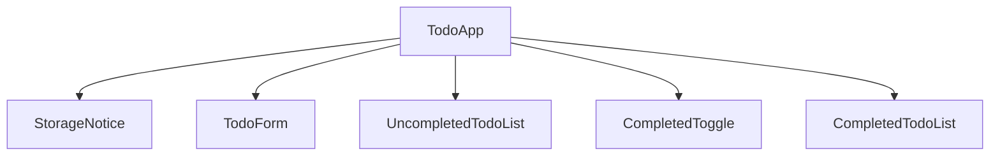

# Frontend Components — u1-todo-app

## Sources

This UI design implements the `TodoApp` responsibilities in
`inception/domain-design/components.md`, the U1 boundary in
`inception/units-generation/unit-of-work.md`, and the interaction requirements
in US1.1 through US1.3.

## Presentation hierarchy

These are UI presentation responsibilities inside the one logical `TodoApp`
component. They may become implementation-level components, but they do not
own independent domain state or storage contracts.

| Presentation part | Inputs and state | Responsibilities |
|---|---|---|
| `TodoApp` | TODO collection, draft, completed visibility, storage status, input error | Owns all state, initializes storage, runs add/toggle/retry workflows, and supplies accessible status messages. |
| `StorageNotice` | storage status, retry and reload actions | Shows read and write failures, explains their consequence, and exposes the available recovery actions. |
| `TodoForm` | draft, input error, mutation-enabled state, add action | Accepts text, shows field-level validation, prevents submission while read storage has failed, and preserves text on validation or write failure. |
| `UncompletedTodoList` | ordered uncompleted TODOs, completion action | Shows actionable checkbox rows or the first-TODO empty state. |
| `CompletedToggle` | completed count, visibility state, toggle action | Shows or hides completed items when any exist and states the next action accessibly. |
| `CompletedTodoList` | ordered completed TODOs, visibility state, completion action | Shows completed rows only while visibility is enabled, with completion distinguishable without color alone. |
| Live status region | status text | Announces successful additions, completion changes, visibility changes, validation feedback, and storage recovery results. |

## Interaction contracts

### Form validation

- Submit validates trimmed text before attempting a storage write.
- Empty or whitespace-only text produces a required-field message.
- Text longer than 500 characters produces a length message.
- Validation keeps the entered text and places focus where the user can correct
  it; successful addition clears the draft.
- A `read-failed` storage status disables the form and explains why. A
  `write-failed` status does not discard the draft or in-memory TODOs.

### TODO row interaction

- Each row has a checkbox labelled with the TODO text.
- Toggling a checkbox changes only the matching TODO's `completed` value.
- A successful toggle updates list membership immediately and announces the
  new state.
- A failed persistence attempt keeps the visual state and opens the recovery
  notice rather than reverting silently.

### Completed visibility

- The control is not required when no completed TODOs exist.
- Its label changes between showing and hiding completed TODOs.
- It changes display state only; it does not persist data.
- Completed rows remain distinguishable through text and semantic state as
  well as visual styling.

### Storage recovery

- A read failure disables adding and completion changes for the loaded page.
- A write failure keeps mutation state in memory and exposes retry and reload.
- Retry persists the complete current in-memory collection, not only the most
  recent operation.
- Reload warns that changes not saved to local storage can be lost.

## Responsive and accessible layout

- At 375px, the form, list rows, and recovery actions remain readable and
  touch-operable without horizontal page scrolling.
- At 768px and 1280px, the content remains centered with a readable line
  length; controls retain their explicit labels.
- Focus order follows the visual order: notice actions, form, uncompleted
  list, completed toggle, then completed list.
- All interactive controls meet keyboard-operation, visible-focus, name, and
  status-notification requirements needed for WCAG 2.2 AA.

