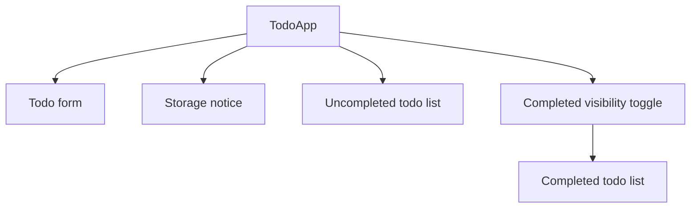
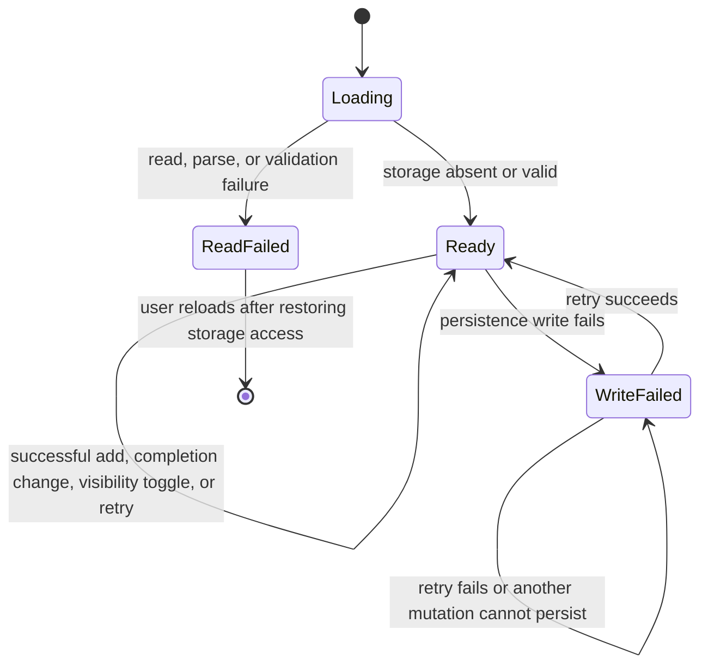

# u1-todo-app Functional Specification

## Scope and sources

This specification covers U1, the single `TodoApp` UI unit. It implements
US1.1, US1.2, and US1.3 using the responsibilities and `Todo` ownership
defined in `inception/domain-design/components.md`; its functional scope and
constraints come from `inception/units-generation/unit-of-work.md`. The
behaviours below fulfil FR1 through FR6 and support NFR1 through NFR3 in
`inception/requirements-analysis/requirements.md`.

No server API, account, editing, deletion, due date, priority, sharing, or
cloud synchronization is part of this unit.

## Logical model

`TodoApp` owns an ordered collection of `Todo` records and the display state
that is not persisted.

| Item | Logical type | Rules |
|---|---|---|
| `Todo.id` | opaque string | Generated once when a TODO is accepted; unique within the saved collection. |
| `Todo.text` | text | Required after trimming leading and trailing whitespace; maximum 500 characters. Text is rendered as text, never interpreted as markup. |
| `Todo.completed` | boolean | Starts as `false`; changes only through the completion control. |
| TODO collection | ordered list | Persisted in creation order. Items retain their positions when their completion state changes. |
| completed visibility | boolean | Starts as `false` on every page load and is not persisted. |
| draft input | text | Held in memory until a successful add clears it. |
| storage status | ready, read-failed, write-failed | `read-failed` disables mutations; `write-failed` preserves the in-memory collection and draft until the user retries or reloads. |

The persisted value is one JSON array under one application-owned local-storage
key. A valid stored item has exactly the required logical fields (`id`, `text`,
and `completed`); an unreadable, malformed, or structurally invalid value is a
storage read failure. This prevents partial or ambiguous data from being
silently treated as a successful empty list.

## Screen and component hierarchy

The form, lists, toggle, and notice are presentation parts of the single
logical `TodoApp` component, not separate domain components.

## Workflows

### W1: Initialize and restore TODOs

1. On page load, set completed visibility to hidden and initialize an empty
   in-memory collection.
2. Read the application storage key.
3. If no value exists, enter the ready state with an empty collection and show
   the first-TODO guidance.
4. If a valid collection exists, restore it in stored order and show only
   uncompleted items.
5. If reading, parsing, or shape validation fails, discard any partially read
   data, enter `read-failed`, show an error explaining that saved TODOs cannot
   be accessed, and disable adding and completion changes. The notice tells the
   user to review browser storage availability and reload after correcting it.

### W2: Add a TODO

1. The user enters text and activates the labelled Add control by pointer or
   keyboard.
2. Trim surrounding whitespace for validation without changing the displayed
   draft until the operation succeeds.
3. If the trimmed text is empty, do not create a TODO; show an input-associated
   error explaining that text is required and retain the draft.
4. If the text exceeds 500 characters, do not create a TODO; show an
   input-associated error explaining the limit and retain the draft.
5. Otherwise, create an uncompleted TODO with a new unique opaque identifier,
   append it to the in-memory collection, and attempt to persist the whole
   collection.
6. On success, clear the draft and input error, update the uncompleted list,
   and announce that the TODO was added.
7. On write failure, retain the appended in-memory TODO and draft, enter
   `write-failed`, and display a notice with Retry save and Reload page actions.

### W3: Change completion state

1. The user activates a TODO's labelled checkbox.
2. Update that TODO's completion state in memory and attempt to persist the
   whole ordered collection.
3. On success, update the currently visible lists. A completed TODO is removed
   from the default list; an uncompleted TODO returns to it in its original
   saved position.
4. Announce the changed completion state to assistive technology.
5. On write failure, retain the in-memory state change, enter `write-failed`,
   and show the same recovery notice. The completed state remains visibly
   represented according to the current completed-visibility setting.

### W4: Show or hide completed TODOs

1. The completed visibility control is available whenever completed TODOs
   exist; its accessible name describes the next action.
2. Activating it toggles only the in-memory display state and does not write
   storage.
3. When enabled, show completed TODOs in a visually and semantically distinct
   completed section. When disabled, hide that section.
4. Announce the new visibility state to assistive technology.

### W5: Recover from a write failure

1. The failure notice identifies that the latest change is currently only in
   the page and has not been saved.
2. Retry save writes the current full in-memory collection, including all
   retained changes, to the same storage key.
3. A successful retry returns to `ready`, clears the notice, preserves a
   retained draft unless its corresponding add was successfully completed, and
   announces success.
4. A failed retry keeps all in-memory data and the notice, with the retry and
   reload choices still available.
5. Reload page follows the browser reload action; unsaved in-memory changes
   may be lost, so the notice states that consequence before the action.

## State transitions

`ReadFailed` is a mutation-disabled terminal state for the loaded page.
`WriteFailed` is recoverable: the page remains interactive and retains the
latest in-memory changes so that one retry saves the current collection.

## Derived rules summary

The authoritative rules are in `rules.md`. BR1.1 validates input, BR1.2 sets
the initial TODO shape and order, BR1.3 controls safe restoration, BR1.4
persists mutations, BR1.5 controls completed visibility, BR1.6 changes
completion accessibly, and BR1.7 retries retained in-memory changes.

## Interaction and accessibility rules

- The text input has a visible label, and its validation error is programmatically
  associated with the input.
- Add, retry, reload, and completed-visibility controls have clear accessible
  names and work with keyboard focus and activation.
- Each completion checkbox exposes the TODO text and its checked state.
- Success, completion-state changes, validation errors, and storage notices
  are announced without relying on color alone.
- The layout remains usable at 375px, 768px, and 1280px widths. Long text wraps
  without being clipped or causing horizontal scrolling of the page.
- Storage reads and writes concern only browser-provided local storage; no
  credentials or networked data are involved.

## Acceptance-criteria traceability

| Acceptance criterion | Design coverage |
|---|---|
| AC1.1.1 | W2 steps 5-6; W1 restoration |
| AC1.1.2 | W2 steps 2-4 |
| AC1.1.3 | W1 steps 1-4 |
| AC1.1.4 | W1 step 3 |
| AC1.1.5 | Interaction and accessibility rules |
| AC1.2.1 | W3 steps 1-4 |
| AC1.2.2 | W3 steps 1-4 |
| AC1.2.3 | W4 steps 1-3 |
| AC1.2.4 | W4 steps 1-3 |
| AC1.2.5 | W3 step 4; Interaction and accessibility rules |
| AC1.3.1 | W1 step 5; state transitions |
| AC1.3.2 | W2 step 7; W3 step 5; W5 |
| AC1.3.3 | W5 step 1; Interaction and accessibility rules |

## Assumptions and open decisions

- The 500-character limit, opaque identifier generation, and one-array storage
  format are reversible implementation decisions made for this learning-sized
  application. They can be changed without a server-side migration.
- Browser-provided storage errors and invalid stored data are both surfaced as
  failures rather than silently discarded.
