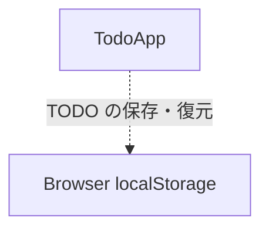

# コンポーネントカタログ

## 参照した入力

- `../requirements-analysis/requirements.md` — FR1〜FR6、NFR1〜NFR5、ローカル利用の制約
- `../user-stories/stories.md` — US1.1〜US1.3 の利用者フロー
- `../practices-discovery/team-practices.md` — 初回の薄い通し実装とテスト方針
- `domain-design-questions.md` — 画面、状態、保存を単一コンポーネントにまとめる選択

```yaml
components:
  - name: TodoApp
    summary: 単一利用者向け TODO の画面、状態、検証、ローカル保存を一貫して管理する。
    behaviour: >
      空白のみの入力を拒否して説明を表示し、有効な TODO を未完了として保存順に追加する。
      TODO の完了・未完了を切り替え、完了済み表示の開閉状態を管理する。読み取り失敗時は保存機能を停止し、
      書き込み失敗時は画面上の変更と入力内容を保持して回復操作を案内する。
    responsibilities:
      - TODO の追加、表示、完了状態の変更、完了済み表示の切り替え
      - TODO 入力の検証と入力エラーの表示
      - ブラウザのローカルストレージからの読み取りと書き込み
      - 保存失敗の画面通知、操作停止、再試行または再読み込みの案内
      - キーボード操作、フォーカス、状態変更の支援技術通知
    depends_on: []
    dependents: []
    external_dependencies:
      - name: Browser localStorage
        kind: other
        purpose: TODO の永続化とページ読み込み時の復元
    entities:
      - name: Todo
        identifier: id
        attributes: [id, text, completed]
        references: []
```

## Component Diagram



## Component Summary

| Component | Purpose | Depends On | Dependents | Entities Owned |
|---|---|---|---|---|
| TodoApp | TODO の画面、状態、検証、保存失敗の回復を管理する | なし | なし | Todo |

## Entity Ownership

| Entity | Owning Component | Identifier | Attributes | References |
|---|---|---|---|---|
| Todo | TodoApp | id | id、text、completed | なし |

## External Dependencies

| Component | Dependency | Kind | Purpose |
|---|---|---|---|
| TodoApp | Browser localStorage | other | TODO の保存と復元 |

## Rationale

| Component | 分離理由 | Alternatives Rejected |
|---|---|---|
| TodoApp | 初回リリースでは画面、状態、保存が同一の小規模な利用者フローを形成し、単一部品で実装と学習対象を理解しやすくする。 | `TodoStore` を分ける案はテスト境界を明確にするが、初回リリースでは部品間連携が増えるため採用しない。画面・状態・保存の3分割はさらに構成を増やすため採用しない。 |

