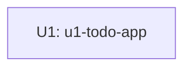

# ユニット依存関係

## 参照した入力

- `../domain-design/components.md` — 単一 `TodoApp` の責務と外部依存
- `../domain-design/decisions.md` — 単一コンポーネント構成
- `unit-of-work.md` — U1 の境界と責務

## Dependency DAG

U1 は唯一のユニットであり、他ユニットへの依存関係はない。



```yaml
units:
  - name: u1-todo-app
    kind: ui
    depends_on: []
```

## Integration Points

| From | To | Integration | Purpose |
|---|---|---|---|
| U1 | Browser localStorage | ブラウザ API | TODO の保存と復元 |

## Parallel Development Opportunities

ユニットは U1 のみであるため、ユニット間で並行実装できる組み合わせはない。

